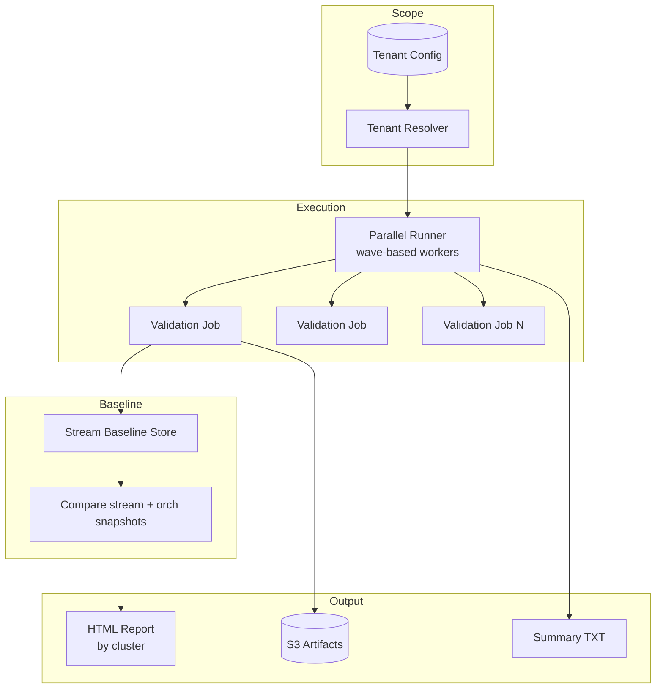

# Post-Upgrade Validation Platform

Portfolio reference implementation of a **parallel, multi-tenant post-upgrade validation pipeline** — the pattern that replaced manual T3 sanity testing (5–6 engineers × ~2 hours) with automated validation of **100+ tenants in 20–30 minutes**, plus **stream baseline comparison in 3–5 minutes**.

> Sanitized rewrite. No proprietary tenant data, credentials, or employer-specific tooling.

**Related repos:**
- [sre-smoke-test-framework](../sre-smoke-test-framework) — continuous per-tenant CronJob smoke tests
- [sre-monitoring-platform](../sre-monitoring-platform) — ongoing synthetic monitoring + alert dedup

---

## Problem this solves

After a platform upgrade, teams need to validate hundreds of tenants quickly:

| Before (manual) | After (this platform) |
|-----------------|----------------------|
| 5–6 engineers split tenants | One automated pipeline |
| ~2 hours per batch of 20 tenants | 100+ tenants in 20–30 min |
| Stream status copied to Notepad | 3–5 min automated baseline diff |
| Scattered pass/fail notes | Cluster-grouped HTML report |

---

## Architecture



---

## Repository layout

```
sre-validation-platform/
├── packages/
│   ├── tenant_resolver/      # Filter tenants by cluster/env/name
│   ├── parallel_runner/      # Wave-based parallel execution
│   ├── stream_baseline/      # Capture + compare stream/orch snapshots
│   ├── report_generator/     # Cluster-grouped HTML reports
│   └── k8s_renderer/           # Validation Job manifest templates
├── scripts/run_validation.py
├── examples/tenants.sample.json
├── infra/k8s/
└── docs/
```

---

## Quick start

```bash
pip install -r requirements.txt
make test
make validation
# Open results/validation-report.html
```

### Stream baseline workflow

```bash
# 1. Capture baselines pre-upgrade
BASELINE_MODE=baseline python scripts/run_validation.py --tenants examples/tenants.sample.json

# 2. Compare post-upgrade
BASELINE_MODE=compare python scripts/run_validation.py --tenants examples/tenants.sample.json
```

---

## Key modules

### Tenant Resolver
Filter validation scope by cluster, environment, or tenant list — from JSON manifest or MongoDB.

### Parallel Runner
Controlled wave execution (`wave_size` + pause) to avoid overwhelming the cluster — mirrors K8s parallel Job deployment.

### Stream Baseline
Capture `stream` and `orch` flow snapshots as JSON; diff against stored baseline:

- status changed
- streams added / removed
- match / no-match per tenant

Replaces manual Notepad copy/compare post-upgrade.

### HTML Report Generator
Cluster-grouped table: tenant, environment, status, detail, duration — built for fast triage by on-call and release teams.

### K8s Job Renderer
Jinja2 templates → per-tenant Validation Job YAML for in-cluster execution.

---

## Metrics this architecture supports

| Metric | Example target |
|--------|----------------|
| Post-upgrade validation (100 tenants) | < 30 minutes |
| Stream baseline compare (100 tenants) | 3–5 minutes |
| False positive rate | < 0.5% |
| Engineer toil per release | ~90% reduction |

---

## Author

**Ifhaam Ahmad** — Site Reliability Engineer  
[LinkedIn](https://linkedin.com/in/ifhaamahmad)

---

## License

MIT — see [LICENSE](LICENSE)
